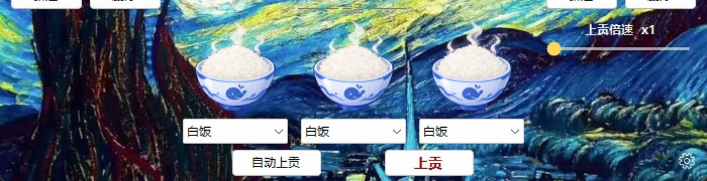

<p align="center">
  
</p>

# Offering Wish Machine

A small Windows desktop widget: pick a deity, hit "Offer", and merit text floats up the screen.

## Features

- **Deities**: each one owns a folder with its image, a title, and several texts popped at random when offering
- **Offerings**: three offering slots fed by images in `Assets/Offerings`; right-click to rename
- **Offering / Auto offering**: click manually, or turn on "Auto offering" to loop at the current speed; 1–50×
<p align="center">
  
</p>
- **Floating text**: at high speeds one offering may pop several texts at once, composited into a single layered window
- **Title & wish**: loaded per deity and written back to that deity's folder as you type
- **Bilingual UI**: follows the system language (English for English systems, Chinese otherwise), switchable from the gear menu
- **Starter assets**: the current assets are embedded in the exe and laid out into `Assets/` on first run; deleted assets do not come back by themselves
- **Log**: `Assets/logs/incense.log`, rotated to `incense.1.log` past 512 KB
- **Background**: right-click the background around the deity to pick a file in `Assets/background` as the background, or add another one
<p align="center">
  
</p>

## Run

Double-click `上贡许愿机.exe`. On first launch it creates `Assets/` next to the exe and lays out the starter assets.

- Gear button: collapse the side panels, transparent list background, UI language
- The current speed is shown next to "Auto offering"; `F10` toggles auto offering by default and can be changed in the gear menu

<p align="center">
  
</p>

## Build

Requires .NET Framework 4.x (included with Windows).

```powershell
.\build.ps1                 # builds 上贡许愿机.exe with the starter assets embedded
.\build.ps1 -NoAssets       # no embedded assets (debug)
.\build.ps1 -Output _test.exe
```

## Asset layout

```
Assets/
  Deities/<name>/          # deity: <name>.png, <name>.meta (title), <name>.wish, 1.txt/2.txt… (popping texts)
  Offerings/               # offering images, file name = offering name
  background/              # background images, first file wins
  logs/incense.log         # offering log
  ui.ini                   # UI settings (speed, hotkey, language)
```

An empty txt in `Deities/<name>/` means "no floating text for this deity"; no txt at all falls back to the default "Merit +1".

## Verify

```powershell
.\verify.ps1
```

Runs the UI regression, the feature regression (speed, floating text, hotkeys, settings persistence, layout) and the language regression in turn; every stage prints `RESULT_OK` on success.

## Tech

C# / .NET Framework 4.x / WinForms, compiled directly with `csc`; the whole UI lives in a single `Form1.cs`.

## Disclaimer

Images, texts and other assets in this project come from the internet or the author's own use, and are provided for personal learning and exchange only. All rights belong to their original owners.

If any material infringes your rights, please reach me via [GitHub Issues](https://github.com/xinm43473-stack/offering-wish-machine/issues). It will be removed promptly after verification.

This project is provided "as is", without warranty of any kind, and the user bears any consequences of using this software.