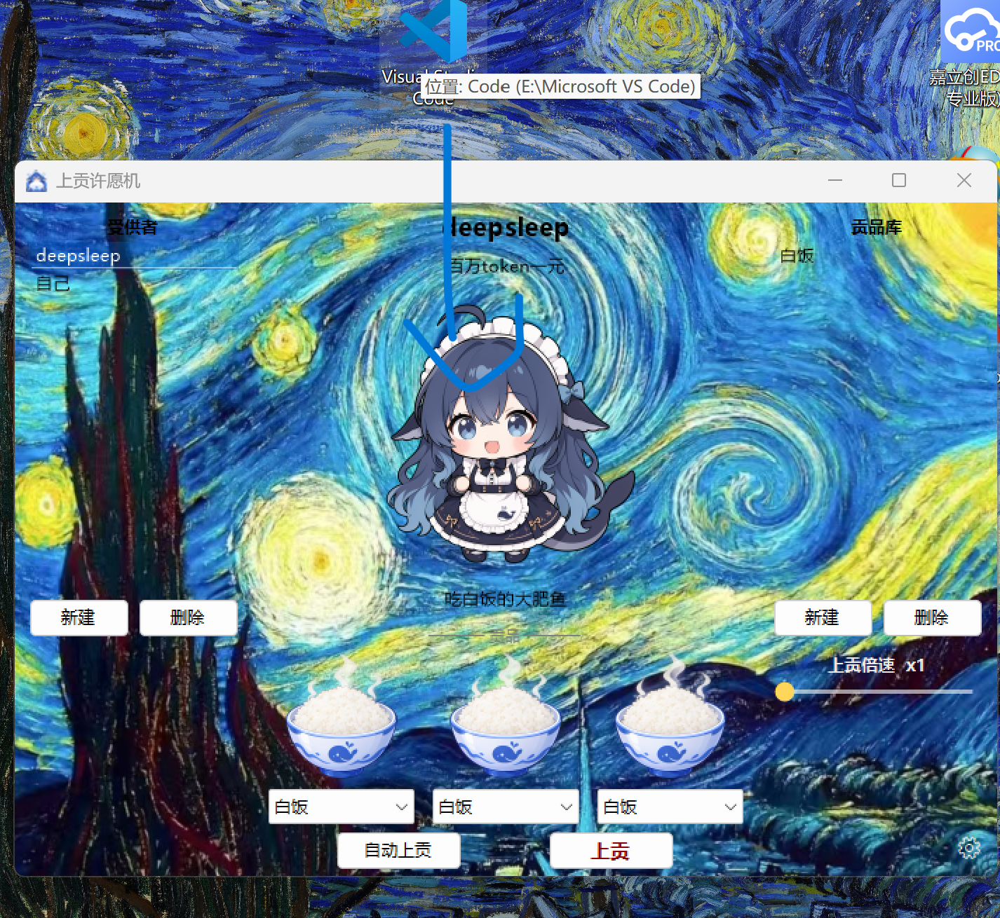
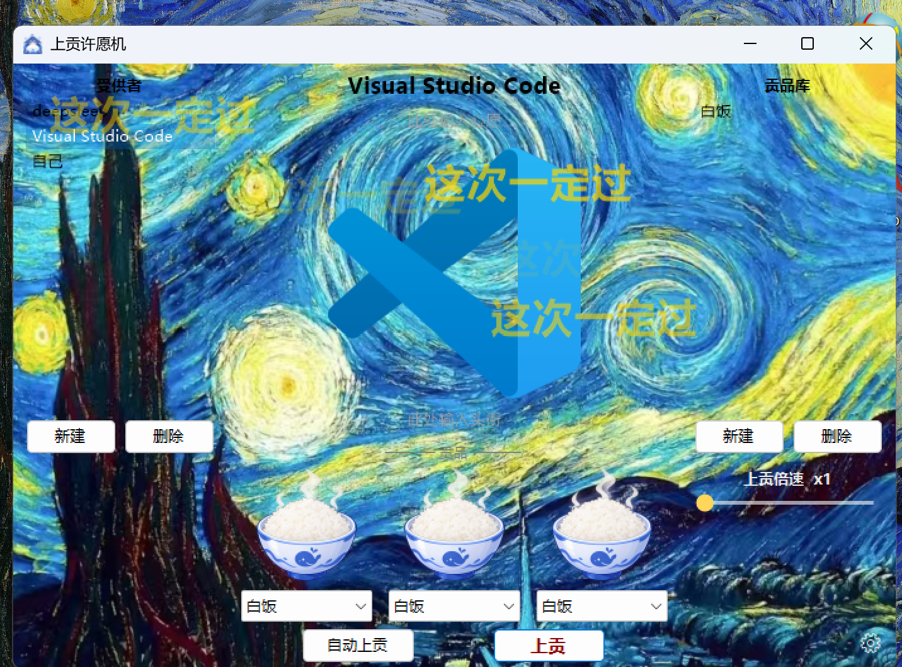
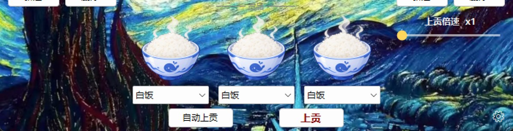

# 上贡许愿机

<p align="center">
  
</p>


[English](./README.md) | **简体中文**

一个 Windows 桌面小工具：选中受供者，点「上贡」，屏幕上飘出功德文字。

## 功能

- **受供者**：每人一个专属文件夹，内含形象图、头衔、以及上贡时随机弹出的若干段文字
- **贡品库**：三台贡品位，图片即素材，右键可重命名
- **上贡/自动上贡**：手动点击，或开启「自动上贡」按倍速循环；1–50 倍速

<p align="center">
  
</p>

- **飘字**：高倍速下一次上贡可能同时飘出多段文字，合成为单个分层窗口渲染

- **头衔与心愿**：切换受供者时各自加载，输入即写回该受供者的文件夹
- **中英双语界面**：跟随系统语言（英文系统用英文，其余一律中文），也可在齿轮菜单里手动切换
- **初始素材**：当前素材已内嵌进 exe，首次运行自动铺到 `Assets/`；删掉的素材不会自己长回来
- **日志**：`Assets/logs/incense.log`，超过 512KB 自动切分为 `incense.1.log`
- **更换背景**：右键受贡者周围背景弹出选择在\Assets\background中的文件作为背景，或添加其他背景

<p align="center">
  
</p>
- **拖入生成受供者**：把文件、文件夹或快捷方式拖到中间头像区即可生成，详见下文「拖入生成受供者」

## 拖入生成受供者

把文件、文件夹或快捷方式直接拖到中间的受供者头像上，就会按照它在资源管理器里的真实样子生成一个受供者，名字默认取文件名：

- **图片文件**：直接复制原图，不套预设图标
- **程序 / 快捷方式**：取资源管理器里显示的真实图标；快捷方式优先用它自己的图标（Edge 的网页应用快捷方式显示站点图标，而不是 Edge 的图标）
- **文件夹**：取资源管理器里的缩略图；系统还没生成缩略图时，用文件夹里前 4 张图片自己拼一张（1 张铺满 / 2 张左右 / 3 张左大右二 / 4 张 2×2）
- **默认飘字**：固定为「这次一定过」，只影响拖入生成，不影响「新建受供者」
- **右键头像**：菜单里「编辑飘字（打开文件夹）」直接打开 `Assets/Deities/<名字>/`，改完 300ms 内生效
- **同名不重复**：已存在同名受供者时只选中它，不覆盖、也不会生成「名字 (2)」

<p align="center">
  
  
</p>
<p align="center">
  
</p>


## 运行

双击 `上贡许愿机.exe`。首次启动会在 exe 同级目录创建 `Assets/` 并铺出初始素材。

- 齿轮按钮：收起侧栏、列表透明背景、界面语言
- 「自动上贡」右侧显示当前倍速；默认快捷键 `F10` 切换自动上贡，可在齿轮菜单里改

<p align="center">
  
</p>

## 构建

需要 .NET Framework 4.x（系统自带）。

```powershell
.\build.ps1                 # 编译为 上贡许愿机.exe，并内嵌 Assets 初始素材
.\build.ps1 -NoAssets       # 不内嵌素材（调试用）
.\build.ps1 -Output _test.exe
```

## 素材结构

```
Assets/
  Deities/<名字>/          # 受供者：<名字>.png、<名字>.meta（头衔）、<名字>.wish（心愿）、1.txt/2.txt…（飘字）
  Offerings/               # 贡品图片，文件名即贡品名
  background/              # 背景图，取目录中第一张
  logs/incense.log         # 上贡日志
  ui.ini                   # 界面设置（倍速、快捷键、语言）
```

`Deities/<名字>/` 里的 txt 内容为空表示该受供者不要飘字效果；没有 txt 则使用默认文字「功德 +1」。

## 验证

```powershell
.\verify.ps1
```

依次执行界面回归、功能回归（倍速、飘字、快捷键、设置持久化、布局）与语言回归，全部输出 `RESULT_OK` 即通过。

## 技术

C# / .NET Framework 4.x / WinForms，用 `csc` 直接编译，界面代码集中在单个 `Form1.cs`。

## 免责声明

本项目中的图片、文字等素材来自网络或作者自用，仅供个人学习与交流，版权归原作者所有。

若相关素材侵犯了您的权益，请通过 [GitHub Issues](https://github.com/xinm43473-stack/offering-wish-machine/issues) 联系我，核实后会立即删除。

本项目按「现状」提供，不附带任何担保，使用本软件产生的后果由使用者自行承担。

